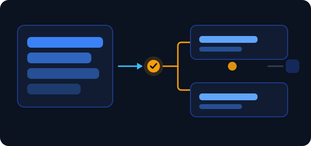

# dsh-nokv implementation notes

This bundle is host-only: one Cordis row, no client half, no browser UI. It registers two model tools on `ctx.tools` and delegates every operation to the native `nokv` CLI. Installation, configuration keys, and the tool table live in the [README](../README.md); this document covers the layers below and their limits.

## Why two tools instead of eighteen

The CLI contract has eighteen workbench tools. Exposing all of them costs every request a large slice of context and asks the model to choose between near-identical names. The bundle therefore splits by risk:

- `nokv_workspace` publishes state: `create`, `put_file`, `append`, `edit`, `commit`, `snapshot`, `snapshot_retire`, `fork`.
- `nokv_query` only reads: `read`, `list`, `stat`, `grep`, `search`, `catalog`, `find`, `snapshot_list`, `operation_status`, and `schema`.
- `schema` runs the CLI's own introspection command, so the remaining unexposed verbs (`aggregate`, for now) stay reachable without pretending this bundle knows their arguments.

`allowWrites: false` skips registering the publishing tool entirely rather than rejecting its calls at execution time: a tool the agent cannot use should not be in its prompt.

## Call path

1. `lib/invoke.js` maps flattened tool parameters to the JSON body one CLI tool expects. It validates what can be validated before a process starts: required fields per operation, the five section names, `put_file`'s text-or-base64 rule, `fork`'s commit-or-snapshot rule, and the 300-item read page bound. The mapping is pure so `test/invoke.test.mjs` covers it without a deployment.
2. `lib/nokv.js` prepends the global route flags in the order the CLI documents, spawns the executable with the inherited environment, bounds stdout to `maxOutputBytes`, arms `timeoutMs`, forwards `exec.signal`, and parses answers: one JSON document on stdout for success, one JSON envelope on stderr for failure, plus the stable exit-code map.
3. `lib/index.js` registers the tools. `execute` returns the CLI envelope as a JSON string, so the canonical tool result is exactly what NoKV said; no field is re-shaped, dropped, or renamed.

## Why the CLI and not the SDK

The CLI is NoKV's own stable agent surface: it fails closed on admission, prints one inspectable schema (`nokv schema`), and carries the retry/identity semantics (`operation_id`, `operation status`) that the model needs. A Host plugin that re-implemented those in JavaScript would have to track a second contract. The cost is process startup per call, which is acceptable for state publishing; a later version can switch to `nokv workbench-session` (JSON lines on stdin/stdout) without changing either tool's surface.

## Failure vocabulary

Failures keep the CLI's classes instead of collapsing into one generic error: the envelope's `code` and `class` are kept, `next_action` is appended to the message so the model knows whether to retry, re-read, or stop, and the exit code is preserved on the error object. The two failures a caller must handle differently are `precondition_failed` (a generation conflict: re-read, then decide) and `identity_conflict` (an operation id reused with different input: never retry blind).

## Deployment facts and credentials

Route flags are configuration because they are stable per deployment. S3 credentials are not: NoKV reads the AWS standard chain, and the Harness loads `$DSH_HOME/.env` into the process environment, so a secret never has to be written into a profile patch that gets shared or committed.

`metadata/run_manifest.json` and `metadata/restore_manifest.json` belong to `workbench_commit` and `workbench_restore`; the write tools cannot address them, which is why the bundle does not try to synthesise a manifest client-side.

## Verification

- `node --test test/` runs the mapping and process-boundary suites against a fake `nokv`: argv order, JSON bodies, the failure envelope (exit 9/11), timeout, abort, output overflow, missing executable.
- The live path needs a deployment; `docs/` in NoKV carries a single-host recipe (bucket + control directory + owner). The bundle's README documents the same facts the tools depend on.

## Limits

- No persistent session yet (see above).
- No `materialize`/`collect`: they exchange local paths, which a sandboxed agent should not gain silently.
- Output is bounded, not paged by the plugin: a `read` that exceeds `maxOutputBytes` is refused with a message telling the caller to narrow with `limit`/`cursor`, never truncated into an invalid JSON prefix.
