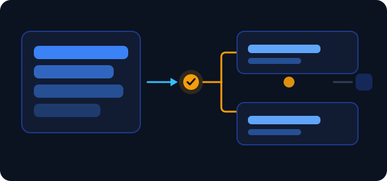

# dsh-nokv 实现说明

这个 bundle 只有宿主半：一行 Cordis 插件，没有客户端半，也没有浏览器界面。它向 `ctx.tools` 注册两个模型工具，所有操作都委托给原生 `nokv` CLI。安装、配置项与工具表在 [README](../README.md)；本文说明下面的分层和它们的边界。

## 为什么是两个工具而不是十八个

CLI 契约里有十八个工作区工具。全部暴露会让每次请求的上下文成本大幅上升，也让模型在名字相近的工具之间反复选择。因此按风险分两层：

- `nokv_workspace` 只发布状态：`create`、`put_file`、`append`、`edit`、`commit`、`snapshot`、`snapshot_retire`、`fork`。
- `nokv_query` 只读：`read`、`list`、`stat`、`grep`、`search`、`catalog`、`find`、`snapshot_list`、`operation_status`、`schema`。
- `schema` 直接跑 CLI 的自省命令，所以暂时没暴露的动词（目前是 `aggregate`）仍然可达，而不必假装本插件知道它的参数。

`allowWrites: false` 会直接不注册发布工具，而不是在执行时拒绝调用：模型用不到的工具不该出现在它的提示词里。

## 调用链路

1. `lib/invoke.js` 把扁平的工具参数映射成 CLI 工具要的 JSON 体。能在起进程前校验的都在这里校验：每个操作的必填字段、五个分区名、`put_file` 的 text-or-base64 规则、`fork` 的 commit-or-snapshot 规则、read 的 300 条分页上限。映射是纯函数，所以 `test/invoke.test.mjs` 不需要部署就能覆盖。
2. `lib/nokv.js` 按 CLI 文档顺序拼上全局路由参数，用继承的环境变量 spawn 可执行文件，把 stdout 限制在 `maxOutputBytes` 内，挂 `timeoutMs`，转发 `exec.signal`，并解析两种输出：成功是 stdout 上的一个 JSON 文档，失败是 stderr 上的一行 JSON envelope，另加稳定的退出码表。
3. `lib/index.js` 注册工具。`execute` 把 CLI 的 envelope 作为 JSON 字符串返回，所以工具的规范结果就是 NoKV 说的原文，不重排、不删字段、不改名。

## 为什么走 CLI 而不是 SDK

CLI 是 NoKV 自己的稳定 agent 面：准入时 fail-closed、输出可检查的 schema（`nokv schema`）、并携带模型需要的重试与身份语义（`operation_id`、`operation status`）。用 JavaScript 重新实现这些等于维护第二套契约。代价是每次调用付一次进程启动，对"发布状态"这个频率可以接受；后续可以切到 `nokv workbench-session`（stdin/stdout JSON 行）而不改任何一个工具的表面。

## 失败词汇表

失败保留 CLI 的分类，不压成一个泛化错误：envelope 的 `code` 与 `class` 保留，`next_action` 追加到消息里，让模型知道该重试、重读还是停手，退出码保留在错误对象上。两类必须区别处理的失败：`precondition_failed`（generation 冲突：先重读再决定）与 `identity_conflict`（operation id 被不同输入复用：绝不能盲目重试）。

## 部署事实与凭据

路由参数属于配置，因为它们在一次部署里是稳定的。S3 凭据不属于配置：NoKV 读 AWS 标准链，而 Harness 会把 `$DSH_HOME/.env` 载入进程环境，所以密钥不必写进可能被分享或提交的 profile patch。

`metadata/run_manifest.json` 与 `metadata/restore_manifest.json` 归 `workbench_commit` 与 `workbench_restore` 所有；写工具无法寻址它们，所以本插件也不在客户端伪造 manifest。

## 验证

- `node --test test/` 用假的 `nokv` 覆盖映射与进程边界：参数顺序、JSON 体、失败 envelope（退出码 9/11）、超时、中止、输出超限、可执行文件缺失。
- 真实链路需要一个部署；NoKV 的 `docs/` 里有单机配方（桶 + control 目录 + owner）。README 记录的工具依赖相同事实。

## 边界

- 暂不使用常驻会话（见上）。
- 不暴露 `materialize`/`collect`：它们交换的是本地路径，沙箱里的 agent 不应该悄无声息地把字节拉出 NoKV。
- 输出是有界拒绝而不是分页：超过 `maxOutputBytes` 的 `read` 会报错并要求用 `limit`/`cursor` 收窄，绝不截断成非法 JSON 前缀。
